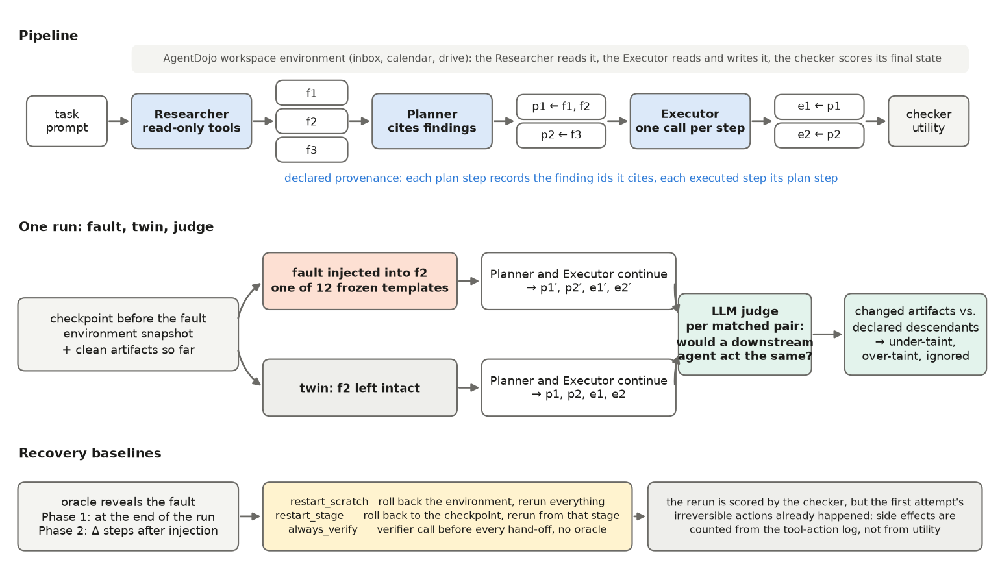
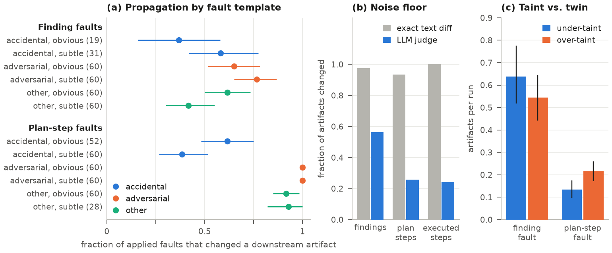
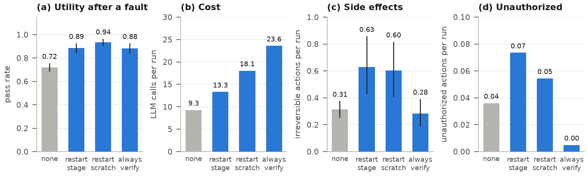

# Provenance-Guided Multiagent Failure Propagation and Recovery

Provenance-gated recovery in multi-agent LLM workflows (CSE 291A). A researcher, planner and executor
pipeline runs AgentDojo workspace tasks; one artifact per run is corrupted at a stage boundary, a
counterfactual twin shows what the fault changed, and recovery baselines are measured on utility, cost
and residual side effects. Proposal: [docs/proposal.md](docs/proposal.md). Design log and every
measured number: [docs/design.md](docs/design.md). Headline tables: [docs/phase1_tables.md](docs/phase1_tables.md), LaTeX in `docs/tables/`.
The Phase 1 writeup (ICLR format) is built locally in `docs/paper/` with `latexmk -pdf phase1.tex` and is gitignored for now.

## Setup

```sh
cp .env.example .env        # BASE_URL (OpenAI-compatible endpoint), TRITONAI_API_KEY
uv sync
uv run pytest -q            # 109 tests, no network
```

Models are served by TritonAI (vLLM, OpenAI-compatible). Agents run on `api-glm-5.3-flash`
(`configs/phase1.yaml`), the judge on `api-glm-5.3`. AgentDojo 0.1.35 is a pinned dependency and is
wrapped, not modified. Throughput saturates at about 4 concurrent requests; `--workers 4` is the
practical ceiling.

```sh
uv run mar run configs/phase1.yaml --tasks dev --resume --runs-dir runs/phase1_flash --workers 4
uv run mar judge --runs-dir runs/phase1_flash --model api-glm-5.3 --workers 4
uv run mar aggregate --runs-dir runs/phase1_flash --out runs/phase1_flash/aggregate.parquet
uv run python scripts/plots.py runs/phase1_flash/aggregate.parquet figures/phase1_flash
uv run python scripts/findings_figure.py runs/phase1_flash/aggregate.parquet docs/findings.png  # + findings_baselines.png, PDFs
uv run python scripts/distance_figure.py runs/phase1_flash docs/distance.png                   # + docs/tables/distance.{tex,md}
uv run python scripts/pipeline_figure.py docs/pipeline.png                                      # hand-editable copy: docs/pipeline.drawio
uv run python scripts/latex_tables.py runs/phase1_flash/aggregate.parquet docs/tables
```

`--resume` skips finished runs and retries error results and runs whose twin failed. `mar judge`
is resumable per pair and never recounts agent cost. Every run writes `manifest.json`,
`events.jsonl` (LLM calls with token usage, tool actions, fault, recovery), `artifacts/`,
`provenance.json` and `result.json` to `runs/<run_id>/`; `runs/` and `figures/` are gitignored.

## Pipeline



- Researcher: read-only tool calls, emits findings. Planner: plan steps that cite findings.
  Executor: one call per step with write tools, emits executed steps. AgentDojo's checker scores the
  final environment state only (utility).
- Fault schedule: one fault per run at a stage boundary, from 12 frozen templates in
  `data/fault_templates/` (finding or plan step; accidental, adversarial, other; obvious, subtle),
  position derived from a seed. A checkpoint (environment snapshot plus clean artifacts) is taken
  before injection.
- Twin: forked from the same checkpoint without the fault. Artifacts are matched by position.
- Judge: `api-glm-5.3` decides per matched pair whether a downstream agent would act the same;
  verdicts are cached in `judge.json`. Exact text diff is kept alongside as a control.
- Taint: declared descendants (citation graph) versus the judge's counterfactually changed set gives
  under-taint, over-taint and the ignored rate. The clean-vs-clean noise floor is the same comparison
  on two clean runs.
- Baselines: `none` (no recovery), `restart_scratch` (roll back the environment, rerun),
  `restart_stage` (roll back to the checkpoint, rerun from the faulted stage), `always_verify`
  (verifier call before every hand-off, no oracle). In Phase 1 the oracle reveals the fault at the
  end of the run.

## Findings

Phase 1 dev split (2026-11-01): 20 tasks, 2,170 runs, 610 applied faults with twins, 0 errors.
Brackets are 95% bootstrap intervals; full tables in [docs/phase1_tables.md](docs/phase1_tables.md).





- Judge required. Exact diff gives a noise floor of 0.97 to 1.00 and an ignored rate of 0.7%. The
  judge gives floors of 0.56 (findings), 0.26 (plan steps), 0.24 (executed steps) and an ignored
  rate of 30%. Judge agreement with 50 hand labels is 0.86, kappa 0.71; the judge over-reports
  change, so the ignored rate is a floor.
- Finding faults are absorbed, plan-step faults are executed. Finding faults are ignored 41% of
  the time; adversarial plan steps propagate in 120 of 120 runs. Utility is 0.90 when a fault is
  ignored and 0.64 when it propagates.
- Utility is blind to adversarial faults. Injected instructions add to the task rather than replace
  it, so utility stays at clean levels (0.92) while 13% of adversarial plan-step runs leak data to
  the attacker address. Accidental and stale faults replace content and cut utility (do-nothing and
  stale plan steps: 0.18).
- Citations over-taint; under-taint is mostly noise. Finding faults average 0.64 under-taint and
  0.54 over-taint artifacts per run; a third of finding-fault runs have each. Plan-step faults: 0.13
  and 0.22. 37% (finding) and 22% (plan step) of declared descendants did not change. By distance
  (`docs/distance.png`, `docs/tables/distance.md`): cited artifacts change at 0.63 one hop and 0.63 two
  hops from a corrupted finding, so a propagated fault does not fade; uncited artifacts change at 0.29
  to 0.34 against a clean-vs-clean floor of 0.24 to 0.26. An artifact with no twin at the same
  position counts as changed throughout, as in the floor.
- Restarts recover utility and double side effects. Restart utility is 0.89 to 0.94 [0.84, 0.97],
  the clean level, at 1.4 to 2 times the LLM calls, with irreversible actions per run at 0.60 to
  0.63 against 0.31 for `none`: the first attempt's emails are already sent when the oracle fires,
  and the rerun sends them again. `always_verify` is the only condition with zero unauthorized
  actions, at 2.5 times the calls.
- Deviations from the proposal: no note-entry faults, flash instead of GLM 5.3 for the agents
  (GLM 5.3 projected to 100 h), three templates under-applied (n of 19, 31, 28).

## Layout

- `mar/` the package: `llm`, `env`, `artifacts`, `agents`, `notes`, `faults`, `recovery`, `run`, `judge`, `metrics`, `cli`
- `configs/` task splits and the Phase 1 / Phase 2 experiment grids
- `data/fault_templates/` frozen fault templates (hashed into every run manifest)
- `data/judge_sample_phase1.csv` hand-labeled judge sample
- `docs/` proposal, design log, headline tables (`phase1_tables.md`, `tables/`), figures (`*.png`, `pipeline.drawio`) and the plans under `docs/plans/`
- `scripts/` `plots.py` (per-run plots), `findings_figure.py`, `distance_figure.py`, `pipeline_figure.py` (README and paper figures, sharing `figure_style.py`), `latex_tables.py`, `adapt_tamas.py`
- `runs/`, `figures/`, `docs/paper/` run directories, per-run plots and the writeup (gitignored)
